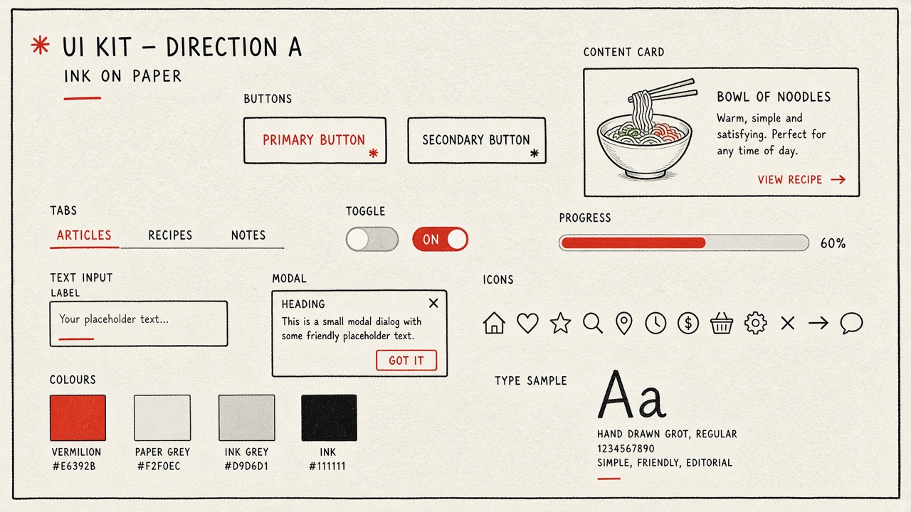

# inkpaperUI · design brief

*Working name.* A line-art UI kit for Tailwind CSS v4, a calm sister to gamifiedUI. Where gamifiedUI
is a lit arcade cabinet, inkpaperUI is a recipe notebook: black ink on warm paper, one red accent,
lines that look drawn by hand.

## Principles

1. **The line is the component.** Shapes are made by one ink outline, not by shadows, gradients or
   depth. If a part needs a fill to be understood, it is the wrong shape.
2. **One accent.** Vermilion marks the one thing to do or the one thing that is on. Everything else
   is ink, greys and paper.
3. **Hand-drawn, not messy.** Lines wobble a little and corners are slightly uneven, but spacing,
   alignment and sizes are strict. The wobble is the same every load, never random.
4. **Quiet motion.** Things are drawn on (a stroke tracing in) rather than bouncing or glowing, and
   nothing moves at all under reduced motion.
5. **Same shape as gamifiedUI.** Class names, tokens and data attributes mirror gamifiedUI
   (`gx-btn` here is `ip-btn`), so a game can switch kits by swapping one import.

## Palette

The board's vermilion is too light for small text on paper, so the kit has two: a bright one for
fills, lines and large type, and a deeper one for text and for filled buttons with white labels.
Contrast is measured against paper.

| Token | Hex | Use | Contrast |
| --- | --- | --- | --- |
| `ip-paper` | `#F2F0EC` | Page and card background | – |
| `ip-ink` | `#111111` | Lines, body text, icons | 16.6:1 |
| `ip-ink-soft` | `#5E5A55` | Secondary text, captions | 6.0:1 |
| `ip-ink-faint` | `#D9D6D1` | Tracks, dividers, disabled fills; never text | – |
| `ip-accent` | `#E6392B` | Accent lines, fills, large type (18px+) | 3.7:1 |
| `ip-accent-ink` | `#C42A1E` | Accent text; filled button with white label (5.7:1) | 5.0:1 |
| `ip-success` | `#2A7252` | Success text and marks | 5.1:1 |
| `ip-warning` | `#87590C` | Warning text and marks | 5.3:1 |
| `ip-danger` | `#C42A1E` | Same as accent ink, always with an icon and words | 5.0:1 |

Danger shares the accent's red on purpose: there is only one red. A danger message is told apart by
its cross icon and its words, never by colour alone.

A dark "ink at night" theme can come later (paper `#1A1917`, ink `#EDEAE4`) once the light theme is
settled.

## Line

- **Weights:** 2px for component outlines and icons at 24px; 1.5px for icons at 16px and for
  dividers; 3px for the focus ring and for a selected tab's underline.
- **Ends and joins:** round caps and round joins everywhere, as a pen leaves them.
- **Corners:** 4px nominal radius, drawn a touch uneven by the wobble. No pill shapes except the
  toggle.
- **Wobble:** outlines are plain CSS borders with each corner's radius a little different
  (`--ip-shape-a`, `-b`, `-c`), so edges meet unevenly the way a pen leaves them. Buttons, cards
  and inputs each use a different shape so neighbours don't look stamped from one mould. SVG
  frames were tried on paper first but bake a colour into every outline, which would block
  theming; CSS filters would warp the text inside.
- **Pen strokes:** underlines (page titles, the open tab, a hovered button) are one wavy SVG line
  used as a mask over the current colour, so they take any colour and draw in with a clip.

## Type

| Role | Font | Notes |
| --- | --- | --- |
| Headings, buttons, labels | Patrick Hand (OFL) | Set in capitals with 0.06em tracking, as on the board |
| Chinese headings | LXGW WenKai TC and LXGW WenKai (OFL) | Hand-written kaishu; TC for 繁, the original for 简 |
| Body | `system-ui` | Long text stays plain and easy to read |

Sizes follow gamifiedUI's three steps (`sm` 0.75rem, `md` 0.875rem, `lg` 1rem) plus a display size
for page titles.

## Icons

A 24 by 24 grid, 2px stroke, round caps, no fills except the accent dot some icons carry (the
active star, the selected heart). Same names as gamifiedui-icons where a match exists (`home`,
`heart`, `star`, `search`, `pin`, `clock`, `money`, `basket`, `settings`, `close`, `arrow-right`,
`chat`, `exit`), so a game's icon calls work in either kit. Each icon has a draw-on variant for
hover.

## States

| State | How it shows |
| --- | --- |
| Rest | Ink outline on paper |
| Hover | The outline thickens to 2.5px and a short scribble underline draws in under the label |
| Pressed | Shifts down 1px; the fill darkens to `ip-ink-faint` |
| Focus | A 3px vermilion hand-drawn ring, 3px outside the outline, also on keyboard focus only |
| Selected / on | Accent: a vermilion underline (tabs), fill (toggle) or tick (checkbox) |
| Disabled | Dashed `ip-ink-faint` outline, `ip-ink-soft` label, no hover |

## First components

The eight parts on the board, built and shown on one demo page in en, 繁中 and 简中:
button (primary, secondary, solid, ghost), card, tabs, switch, progress bar, text input, dialog and
the icons above. The second batch adds checkbox and radio (a red pen tick and dot), badge, alert
(a tone line down the start edge plus an icon) and tooltip.

## Open questions

- The final name and class prefix (`inkpaperUI` / `ip-` is a working choice).
- Whether the corner-radius wobble is enough, or long edges should bend too (SVG frames per theme).
- Whether the dark theme is in the first release.
